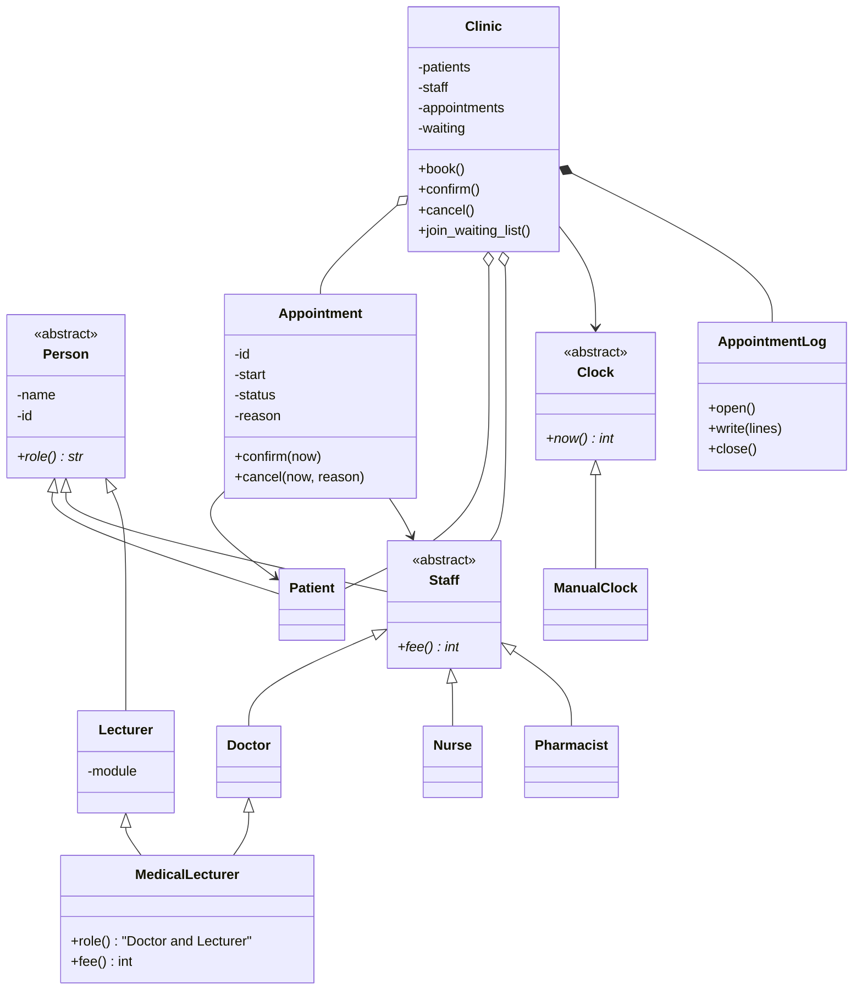

# Clinic Appointment System

Python 3.11+ (developed on 3.13). Standard library only.

```
python3 main.py              # 5-minute demo
python3 -m unittest -v       # test suite
```

## Configuration

`clinicsys/config.py` holds the single constant `P = 4` used by the fee formulas and by the choice of twist.

| Quantity | Value for P = 4 |
|---|---|
| Doctor fee `40 + 5 * (P mod 5)` | 60 |
| Nurse fee `10 + (P mod 3)` | 11 |
| Pharmacist fee | 5 |
| Twist `P mod 4` | 0 (waiting list) |

## Layout

| File | Content |
|---|---|
| `clinicsys/people.py` | Person, Patient, Staff, Doctor, Nurse, Pharmacist, Lecturer, MedicalLecturer |
| `clinicsys/appointment.py` | Appointment, Status, legal transitions, read-only AppointmentView |
| `clinicsys/clinic.py` | Clinic (rules, waiting list, logging) |
| `clinicsys/log.py` | AppointmentLog (open once, close once) |
| `clinicsys/clock.py` | Clock (abstract), ManualClock |
| `clinicsys/errors.py` | ClinicError, RuleViolation, IllegalTransition, NotFound, LogError |
| `main.py` | Demo |
| `tests/test_clinic.py` | Unit tests |

## 1. Class diagram



## 2. Encapsulation, status changes and construction rules

**Hidden fields.** Every field is stored under a double-underscore name (`self.__status`), so Python mangles it and outside code cannot reach it by accident. Values are exposed only through read-only properties; assigning to `patient.name` raises `AttributeError`.

**No leaked lists.** `Clinic.staff()`, `patients()`, `appointments()` and `waiting_list()` return new tuples, never the internal containers. `appointments()` returns frozen `AppointmentView` snapshots, and `book()` returns only an id, so a caller cannot hold a live `Appointment` and change it behind the clinic's back.

**Status changes.** The only way to change a status is `Appointment.confirm(now)` or `Appointment.cancel(now, reason)`. Legal transitions:

| From \ To | PENDING | CONFIRMED | CANCELLED |
|---|---|---|---|
| PENDING | - | yes | yes |
| CONFIRMED | no | no | yes (not within 2 h of start) |
| CANCELLED | no | no | no |

Rules enforced inside `Appointment`:

- A cancelled appointment never returns: the transition table has no outgoing edge from CANCELLED, and any attempt raises `IllegalTransition("already cancelled")`.
- A confirmed appointment cannot be cancelled when `start - now < 2`: raises `RuleViolation("too late")`.
- Nothing changes once `now >= start`: raises `RuleViolation("already started")`.

**Constructors.** `Person` strips the name and raises `ValueError` if it is empty (`TypeError` if it is not text). The id must support integer conversion and be greater than zero, otherwise `ValueError` / `TypeError`. `Appointment` rejects ids below 1 and start hours outside 0-167. `Lecturer` applies the same check to the module name.

**Invariants** are written as comments directly above `Appointment` (`appointment.py`) and `Clinic` (`clinic.py`).

## 3. Roles and fees with no type checks

```python
for member in clinic.staff():
    print(member.role(), member.fee())
```

`role()` and `fee()` are abstract in `Person` / `Staff`, and each subclass supplies its own. The loop only calls the two methods (polymorphism), so it is the same for every subclass. `Clinic` stores staff by id and never asks what kind they are. The source contains no `isinstance`, `issubclass` or `type(...)` call and no type tag; a test scans the package to confirm it. A new subclass of `Staff` (a test adds `Receptionist`) works with the loop and the Clinic unchanged.

## 4. Logging that always opens and closes once

Mechanism: the context manager protocol (`with` statement, `__enter__` / `__exit__`).

- `Clinic.__enter__` calls `AppointmentLog.open()`, which prints `[log] opened`.
- `Clinic.__exit__` calls `AppointmentLog.close()`, which prints `[log] closed`. Python runs `__exit__` whether the block ends normally or an exception escapes, so the log is closed on every path.
- The log itself is a small state machine (`new -> open -> closed`). `open()` raises if called a second time and `close()` does nothing when the log is not open, so neither can happen twice. Tests check `opens == 1` and `closes == 1` after normal exit and after an escaping error.
- Every Clinic operation runs inside a private `__action(label)` context manager. If the operation fails, it writes `FAILED <label>: <reason>` and re-raises, for example `[t=19] FAILED cancel #1: too late`.

`main.py` ends with a deliberate failure raised inside the `with` block; the output shows `[log] closed` before the error is reported.

## 5. Lecturer and MedicalLecturer

```
MedicalLecturer -> Doctor -> Staff -> Lecturer -> Person
```

All constructors use cooperative `super().__init__(...)`, and only `Person.__init__` does the real work. Because Python's method resolution order contains `Person` once, it runs exactly once. `Person.constructions()` is the counter; the demo and a test show it increases by 1 when a `MedicalLecturer` is created.

`MedicalLecturer.fee()` returns the doctor's fee (`super().fee()`, which resolves to `Doctor.fee`). A `Lecturer` has no fee of its own, and the person is paid for the clinical work, so the lecturing role adds nothing and the value stays consistent with a plain `Doctor`. `role()` returns `"Doctor and Lecturer"`.

**Java.** A class may extend only one class, so `Lecturer` would become an interface (`String module()` plus a `role()` declaration). `MedicalLecturer extends Doctor implements Lecturer`, stores its own module-name field, and implements `module()`. Only the `Doctor` chain extends `Person`, so `Person` is constructed once. Plain `Lecturer` objects become a small class implementing the interface (and extending `Person`), because an interface cannot hold the constructor, the field or the validation.

## 6. Rules between objects and the twist

- Conflicts: `Clinic.__conflict` refuses a booking if a non-cancelled appointment at the same hour already uses the same staff member or the same patient. Cancelled appointments do not block.
- Unique ids: patients and staff share one id space, checked at registration; appointment ids are assigned by the clinic from 1 and never reused.
- Clean failure: every check runs before anything is stored, and the log line is written before the change is applied. A broken rule raises a `ClinicError` subclass, leaves the state untouched and produces a `FAILED ...` log line.

**Twist 0 - waiting list.** `join_waiting_list(patient_id, staff_id)` appends the patient to that staff member's list. When `cancel()` succeeds, the Clinic walks that list in order and picks the first patient who is not the cancelling patient and has no conflict at that hour. It creates a new PENDING appointment for that patient, removes them from the list, and logs `offered slot ... new #n PENDING` in the same log write as the cancellation.

## 7. Design decision log

**D1. Where does the 2-hour rule live?** In `Appointment`, with the notice length in `config.CANCEL_NOTICE_HOURS`. The rule needs only the appointment's own start, its own status and the current time, so the object that owns the status is the one that can guarantee the invariant; nobody can cancel around it. Alternatives:
- `Clinic`: easy to see all rules in one place, but any code reaching an appointment directly could bypass it, and the Clinic would need to read appointment internals.
- `Staff`: staff do not know about appointments, so it would add a dependency that has no other reason to exist.
- Separate policy object: lets the rule differ per clinic or per staff type without editing `Appointment`, at the price of one more class and an extra argument to pass around. It is worth adding if rules start to vary; for one fixed rule it is more machinery than needed.

**D2. Why is the clock testable?** Code only calls `clock.now()` on a `Clock` it was given. Tests and the demo use `ManualClock`, which they can move to any hour. If the system time had been called directly, the "too late" rule (cancel at hour 19 for an hour-20 appointment), the "already started" rule, and the past-booking check could only be tested by waiting in real time or patching the interpreter; results would also differ between runs. Time here is a whole number of hours from 0 to 168, which no real clock supplies anyway.

**D3. Adding Pharmacist.** Nothing besides the new class. `Clinic`, the print loop, `Appointment` and the log did not change, because they only use `role()` and `fee()`. The only other place is where the program creates a pharmacist object (the demo registers one), which is data, not logic. Nothing leaked.

**D4. MedicalLecturer.fee() and the single Person.** It returns the doctor fee (see section 5). Python's method resolution order (C3 linearisation) together with cooperative `super().__init__` stops `Person` being created twice. Without it, for example by calling `Doctor.__init__(self, ...)` and `Lecturer.__init__(self, ...)` by hand, each would call `Person.__init__`: two initialisations of the name and id, the counter at 2, and the second call could overwrite what the first set. In C++ the equivalent is virtual inheritance.

**D5. What if the log itself fails?** The log is a write-ahead record, so a failure to write is treated as a failure of the action:
- Write failure: `AppointmentLog` raises `LogError` before the change is applied, so the clinic state stays as it was and the caller learns the action did not happen. A `LogError` is not itself logged (that would fail again). A test checks that a booking attempted while writes fail leaves no appointment, and the same booking succeeds once writes work.
- Close failure: the log is still marked closed (so close is not attempted twice), the stream is released, and `LogError` is raised. If another error is already propagating, that original error is kept and the close failure is only reported on standard error, so the root cause is not masked.
- Open failure: `LogError` is raised from `__enter__`, so the clinic is never used without a log.

**D6. Twist 0 answers.** The Clinic owns the waiting list. Offering a freed slot needs information from several objects (the staff member's list, every patient's other appointments, the new appointment id and the log), and only the Clinic sees all of them and already enforces the no-conflict rule. A list stored inside `Staff` would force staff to know about patients and appointments; a list inside `Patient` would have no ordering across patients. The other twists are not implemented in this version, so their questions do not apply.

## 8. Demo

`python3 main.py` walks through, in order: roles and fees from one loop; registration with duplicate-id, empty-name and bad-id failures; booking, confirming and the two conflict failures; the waiting list with the automatic offer after a cancellation; the single `Person` construction for `MedicalLecturer`; the 2-hour rule driven by the clock; and finally a deliberate failure (cancelling an appointment that has already started) raised inside the `with` block, after which `[log] closed` is printed and the log file content is shown.
